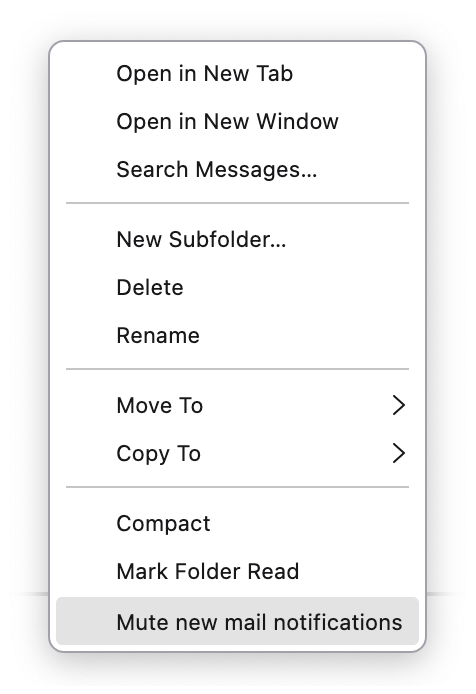

=========================
Mute Folder Notifications
=========================

A tiny Thunderbird add-on that lets you **mute new-mail notifications for a
folder and its subfolders** from the folder's context menu.

Because it acts when the alert is about to be shown, it keeps working when a
**filter moves incoming mail into a muted folder**: the message still arrives,
but no notification pops up.

   Right-click a folder and tick **Mute new mail notifications**.

   A muted folder is marked with a discreet crossed-out bell in the folder pane.

Features
========

- Right-click a folder → **Mute new mail notifications** (checkbox).
- Applies to the folder **and all its subfolders**, including ones created later.
- A discreet 🔕 icon is shown next to muted folders in the folder pane
  (fainter for subfolders muted through a parent).
- Works with messages delivered by filters, junk handling or manual moves.
- Muting a folder never hides new mail arriving in other (unmuted) folders.
- The muted list survives restarts and follows folders when they are renamed
  or moved.
- Muting an account's root folder mutes the whole account.

Compatibility
=============

Thunderbird **140.0 and later** (developed and tested on 140.17.0 ESR).

Installation
============

1. Download ``mute-folder-notifications.xpi`` from the
   `Releases page <https://github.com/netitbe/thunderbird-mute-folder/releases>`_,
   or build it yourself (see `Building`_).
2. In Thunderbird: **Add-ons and Themes** → gear icon → **Install Add-on From
   File…** and select the XPI.
3. If Thunderbird refuses the unsigned add-on, open **Settings → General →
   Config Editor** and set ``xpinstall.signatures.required`` to ``false``, then
   retry.
4. Restart Thunderbird.

Usage
=====

Right-click any folder in the folder pane and tick **Mute new mail
notifications**. Untick it to restore notifications. If a folder is muted only
because a parent is muted, the entry is shown checked and disabled; unmute the
parent instead.

What it does *not* do
=====================

Only the **alert** (system notification or alert window) is suppressed. The
new-mail **sound**, the dock/taskbar **unread badge** and unread counters still
behave as usual.

Permissions
===========

.. list-table::
   :header-rows: 1
   :widths: 20 80

   * - Permission
     - Why
   * - ``menus``
     - Adds the entry to the folder context menu.
   * - ``accountsRead``
     - Identifies the folder you right-clicked and gives it a stable id.
   * - *Experiment API*
     - Thunderbird shows this as "Have full, unrestricted access to
       Thunderbird, and your computer". It is unavoidable for any Experiment,
       and required here because a regular WebExtension cannot influence
       notifications.

The experiment does only three things: it wraps one method of Thunderbird's
``MailNotificationManager``, stores the muted folder ids in the preference
``extensions.mutefolder.ids``, and injects a small style rule in the folder
pane. No network access, no file access, no reading of message content.

How it works
============

Every new-mail alert goes through
``MailNotificationManager._getNewMsgKeysNotNotified(folder)``. The add-on wraps
it so it reports "nothing new" for muted folders (and their descendants). Since
the check happens per folder at alert time, it does not matter how the message
got there.

Because this relies on a Thunderbird internal, a future major release could
change it and require an update.

Customizing the folder icon
===========================

The icon is plain CSS in the ``CSS`` constant at the top of
``implementation.js`` (glyph via ``content``, size, opacity, position). Rebuild
after any change.

Building
========

.. code-block:: sh

    git clone https://github.com/netitbe/thunderbird-mute-folder.git
    cd thunderbird-mute-folder
    ./build.sh

Produces ``dist/mute-folder-notifications.xpi`` (a zip with ``manifest.json``
at its root). Requires ``zip``. Bump ``version`` in ``manifest.json`` before
each release. To regenerate the PNG icons from ``icons/icon.svg``:

.. code-block:: sh

    for s in 32 48 64 96; do rsvg-convert -w $s icons/icon.svg -o icons/icon-$s.png; done

Project layout
==============

::

    manifest.json         Add-on manifest (MV2, experiment declaration)
    background.js         Context menu, rename/move tracking
    implementation.js     Experiment API: notification patch, storage, folder-pane icon
    schema.json           Experiment API schema
    icons/                Add-on icons (SVG source + PNGs)
    build.sh              Builds the XPI

Issues
======

Bug reports and suggestions:
https://github.com/netitbe/thunderbird-mute-folder/issues

License
=======

Copyright (c) Netitbe SPRL, Laurent Lasudry <laurent@netitbe.be>

Licensed under the GNU General Public License v2.0 only (``GPL-2.0-only``),
see the ``LICENSE`` file.
